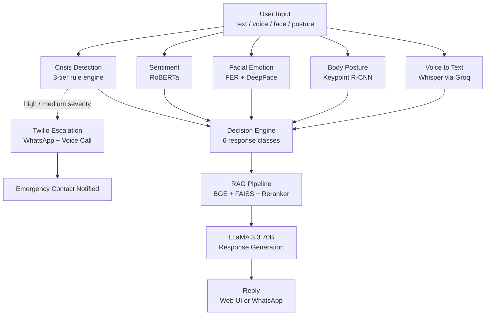

# HealMatrix AI

### A Multimodal Reasoning Framework for Crisis-Aware Mental Health Support

HealMatrix AI is a final year project from the Department of Artificial Intelligence at the University of Management and Technology (UMT), Lahore. It is a mental health support prototype that goes beyond text-only chatbots: it listens to what a person types or says, looks at their facial expression and body posture, and combines all of these signals to understand how they are really feeling.

Each reply is grounded in CBT, DBT and ACT material through a retrieval pipeline and generated with LLaMA 3.3 70B. Safety is handled separately by a rule-based crisis engine that does not depend on the language model. If high-risk language is detected, the system alerts a trusted emergency contact on WhatsApp and, for high severity, places a voice call through Twilio.

**Quick links:** [Video Demo (LinkedIn)](https://www.linkedin.com/feed/update/urn:li:activity:7486145845353172992/) · [Research Paper (publication pending)](#research-paper) · [Kaggle Notebook](https://www.kaggle.com/code/asjaddasjadd/healmatrix-ai) · [Quick Start](#-quick-start) · [Results](#-results)

---

> **Disclaimer:** HealMatrix AI is an academic research and engineering prototype. It is **not** a medical device, does not provide clinical diagnoses, and must not be used as a substitute for professional mental health care. If you or someone you know is in immediate danger, contact local emergency services.

---

## Research Paper

> **Publication status:** The research paper associated with this project, *"HealMatrix AI: A Multimodal Reasoning Framework for Crisis-Aware Mental Health Support Using Facial Emotion Recognition, Posture Analysis, and Retrieval-Augmented Generation"*, is **original work written entirely by Ali Asjad**. It has **not yet been published** and will be submitted for publication soon. The manuscript is shared in this repository (`docs/`) for transparency and project documentation only. This section will be updated with the official venue, DOI, and final citation once the paper is published.

Please do not reproduce or redistribute the manuscript as a published work. If you build on this project before publication, you may reference the GitHub repository directly.

---

## Table of Contents

0. [Research Paper](#research-paper)
1. [Overview](#-overview)
2. [Key Contributions](#-key-contributions)
3. [Features](#-features)
4. [System Architecture](#-system-architecture)
5. [Decision Classes](#-decision-classes)
6. [Crisis Escalation Policy](#-crisis-escalation-policy)
7. [Results](#-results)
8. [Live Deployment Evidence](#-live-deployment-evidence)
9. [Quick Start](#-quick-start)
10. [Usage](#-usage)
11. [Training and Evaluation](#-training-and-evaluation)
12. [Repository Structure](#-repository-structure)
13. [Limitations and Ethics](#-limitations-and-ethics)
14. [Roadmap](#-roadmap)
15. [Citation](#-citation)
16. [Author and Acknowledgments](#-author-and-acknowledgments)

---

## Overview

Most mental health chatbots read only typed text. That discards much of the emotional signal present in real human interaction (tone, facial expression, posture) and often leaves crisis detection to the implicit judgment of a language model, which is neither guaranteed nor auditable.

**HealMatrix AI** addresses both problems. It accepts text, voice, a facial image, and a full-body posture image; converts each into a structured signal; fuses those signals into a single context; retrieves grounded passages from a curated **CBT / DBT / ACT** knowledge base; and generates a response with **LLaMA 3.3 70B**. Every reply is assigned one of six logged **decision classes**, so the reasoning behind it is visible rather than hidden.

Safety is handled by a **rule-based crisis engine that runs outside the LLM**. When high-risk language is detected, the system alerts a designated emergency contact through Twilio (WhatsApp, plus a voice call for high severity). The language model shapes the *wording* of the reply but can never suppress an escalation.

---

## Key Contributions

| # | Contribution |
|---|--------------|
| 1 | **Multimodal late-fusion pipeline** combining facial emotion, body posture, text sentiment, and voice into one emotional-state estimate. |
| 2 | **Deterministic crisis detection and escalation**, decoupled from the LLM, triggering real WhatsApp alerts and voice calls via Twilio. |
| 3 | **Two-stage RAG** (BGE + FAISS retrieval, cross-encoder reranking) that grounds replies in therapeutic literature. |
| 4 | **Decision engine** that maps all signals to one of six explicit, logged response classes. |
| 5 | **Comparative evaluation** of three facial-emotion architectures and of RoBERTa against a Naive Bayes baseline. |
| 6 | **Transparent methodology reporting**, including diagnosed evaluation defects, majority-baseline comparisons, and honest caveats. |
| 7 | **Full deployment**: Gradio web UI and WhatsApp (Flask + Twilio webhooks), containerized with Docker, demonstrated via a QR-code mobile tunnel. |

---

## Features

| Capability | Description | Technology |
|---|---|---|
| Multimodal input | Text, microphone audio, facial image, posture image, location string | Gradio |
| Voice transcription | Low-latency speech-to-text | Groq Whisper large-v3-turbo |
| Facial emotion | 7-class affect with confidence-based cascade (FER, falling back to DeepFace below 0.60 confidence) | FER, DeepFace |
| Body language | 17 COCO keypoints converted to 5 geometric features, classified as confident / tense / slouched / neutral | PyTorch Keypoint R-CNN (ResNet-50-FPN) |
| Text sentiment | Polarity and confidence scoring | Fine-tuned RoBERTa |
| Crisis engine | Three-tier (high / medium / low) keyword and phrase matcher | Rule-based, LLM-independent |
| Grounded replies | Dense retrieval, reranking, context-injected prompting | BGE-small-en-v1.5, FAISS, cross-encoder |
| Response generation | Trauma-informed therapeutic persona | Groq, LLaMA 3.3 70B |
| Audio replies | Spoken output for accessibility | gTTS |
| Therapist finder | Geocodes a location and lists nearby providers with rating, contact, and open status | Google Maps Places and Geocoding APIs |
| Emergency escalation | WhatsApp alert and automated voice call to an emergency contact | Twilio |
| Session dashboard | Message counts, detected emotions, crisis alerts, session duration | Local JSON store |
| WhatsApp channel | Same pipeline reachable from a phone | Flask + Twilio webhooks |
| Reproducible deployment | Single-command environment | Docker, Docker Compose |

---

## System Architecture



### Design principles

- **Safety is not a model output.** The crisis path is deterministic and runs in parallel with, and takes priority over, generation.
- **Late fusion.** Each specialist model emits a lightweight structured signal; fusion happens at the signal level, not on raw data.
- **Graceful degradation.** A missing image or a failed module is skipped without crashing the pipeline.
- **Grounding before generation.** Retrieved CBT/DBT/ACT passages are injected into the prompt to constrain the LLM.
- **Observability.** Signals, decisions, and escalation events are logged locally for auditability.

---

## Decision Classes

| Class | When it is chosen | Behavior |
|---|---|---|
| `ESCALATE` | High-severity crisis signal | Calm safety script, emergency resources, confirms human contact was notified |
| `REFER_THERAPIST` | Explicit request or recurring crisis history | Explains professional options and runs the location-based therapist search |
| `REASSURE` | Medium severity, or concurrent negative multimodal signals | Validation plus grounding / distress-tolerance exercise |
| `GUIDE` | Concrete problem under moderate distress | Walks through a specific technique (for example a CBT thought record) |
| `MOTIVATE` | Default for low mood or energy without acute risk | Behavioral activation and small next steps |
| `ASSESS` | Insufficient or contradictory signals | Targeted clarifying, screening-style questions |

---

## Crisis Escalation Policy

| Severity | Trigger | Action |
|---|---|---|
| **Low / Medium** | Lexical match in the corresponding tier | WhatsApp alert to the configured emergency contact |
| **High** | Explicit self-harm or suicide language | WhatsApp alert **and** automated voice call; `ESCALATE` response to the user |

Alerts are intentionally minimal and factual. This path executes regardless of what the language model returns.

---

## Results

All numbers below are taken from the paper and the public Kaggle notebook.

| Module | Metric | Result |
|---|---|---|
| Facial emotion, initial fine-tuned classifier | Accuracy / Macro F1 | 69.4% / 0.647 |
| Facial emotion, custom CNN (from scratch) | Validation accuracy | 67.74% |
| Facial emotion, EfficientNet-B2 (final run) | Accuracy / Macro F1 | 68.44% / 0.661 |
| Posture, MobileNetV2 | Accuracy / Weighted F1 | 50.65% / 0.511 |
| Sentiment, Naive Bayes baseline | Accuracy / Macro F1 | 70% / 0.66 |
| Sentiment, **RoBERTa** | Accuracy / Macro F1 | **88% / 0.86** |
| RAG retrieval, BGE (pretrained vs fine-tuned) | Recall@4 / MRR | ≈0.75 / ≈0.59 vs ≈0.60 |

### How to read these results

- **Facial emotion.** Three independently trained architectures converge in the 67.7 to 69.4% range, suggesting a ceiling that comes from the FER-2013 label taxonomy (notably confusion among fear, sad, and disgust) rather than from any single training run. These are *comparative* models; the production FER/DeepFace cascade has not yet been benchmarked on the same test split.
- **Posture.** Evaluated on 691 held-out MPII images with MediaPipe-derived reference labels. Overall accuracy (50.65%) is marginally below a majority-class baseline (50.80%, always predicting *slouched*), so per-class results matter more: recall is non-trivial on all four classes (0.18 to 0.70). Class imbalance in the minority classes is the main remaining bottleneck.
- **Sentiment.** RoBERTa gains 18 points in accuracy and 20 points in macro F1 over Naive Bayes, with the largest improvement on the ambiguous *Neutral* class. Evaluation used a general COVID-19 tweet dataset, not mental-health-specific text.
- **RAG.** The fine-tuned versus pretrained gap is small. An earlier run silently fell back to the pretrained checkpoint, so this difference is treated as suggestive, not conclusive.

---

## Live Deployment Evidence

### Video Proof

A recorded demonstration of the working system is available on LinkedIn:

**[Watch the HealMatrix AI demo video](https://www.linkedin.com/feed/update/urn:li:activity:7486145845353172992/)**

The paper documents the system running as a real deployment, not only in offline tests:

- **Deployed web interface** with all analysis modules and a persistent crisis-hotline banner.
- **Live facial emotion** results on two test images (happy at 100% confidence, sad at 53.7%).
- **Live posture analysis** showing 17 COCO keypoints and the derived geometric features.
- **Real crisis-escalation event:** a high-severity message sent to the WhatsApp deployment triggered a WhatsApp alert and an automated incoming voice call within seconds, captured on a mobile device (Fig. 8 in the paper).
- **QR-code mobile access** through a public tunnel, so reviewers can test from a phone with no local install.
- **Session-statistics dashboard** with real-time analytics and the severity-based alert policy.

> Screenshots can be placed in `docs/images/` and linked here.

---

## Quick Start

### Prerequisites

- Python 3.10 or newer
- Optional GPU (recommended for training only)
- API accounts and keys for **Groq**, **Google Maps Platform**, and **Twilio**

### 1. Clone and install

```bash
git clone https://github.com/aliasjad6536/healmatrix-ai.git
cd healmatrix-ai

python -m venv .venv
source .venv/bin/activate        # Windows: .venv\Scripts\activate

pip install --upgrade pip
pip install -r requirements.txt
```

### 2. Configure environment

Create a `.env` file in the project root. Credentials are read only from environment variables and are never hard-coded.

```env
GROQ_API_KEY=your_groq_key
GOOGLE_MAPS_API_KEY=your_maps_key
TWILIO_ACCOUNT_SID=your_sid
TWILIO_AUTH_TOKEN=your_token
TWILIO_WHATSAPP_FROM=whatsapp:+14155238886
TWILIO_VOICE_FROM=+1xxxxxxxxxx
EMERGENCY_CONTACT_NUMBER=+92xxxxxxxxxx
```

> Never commit `.env`. Make sure it is listed in `.gitignore`.

### 3. Build the knowledge base

```bash
python build_knowledge_base.py
```

### 4. Run

**Locally:**

```bash
python main.py
```

**With Docker:**

```bash
docker compose up --build
```

Open the Gradio interface at **http://localhost:7860**.

---

## Usage

| Tab | What you can do |
|---|---|
| **Therapy Chat** | Type a message, see the decision-class badge, and read the RAG-grounded reply |
| **Voice** | Record audio for transcription and receive a spoken reply |
| **Emotion Detection** | Upload or capture a face image to see per-emotion confidence |
| **Body Language** | Upload a full-body image to view keypoints and posture classification |
| **Sentiment Analysis** | Inspect polarity and confidence for any text |
| **Therapist Finder** | Enter a city or area to list nearby providers |
| **Statistics** | View session metrics, emotion history, and crisis-alert counts |

---

## Training and Evaluation

Each component can be trained and validated independently, or all at once:

```bash
python download_datasets.py        # fetch datasets (with fallback mirrors)
python run_all_training.py         # train all components

python check_emotion_weights.py    # validate emotion checkpoint
python check_pose_weights.py       # validate pose checkpoint
python check_rag_weights.py        # validate retrieval checkpoint
```

The complete training and evaluation notebook is also available on Kaggle:
[`asjaddasjadd/healmatrix-ai`](https://www.kaggle.com/code/asjaddasjadd/healmatrix-ai), including checkpoints, confusion matrices, and retrieval charts.

**Datasets used**

| Task | Dataset |
|---|---|
| Facial emotion | FER-2013 Enhanced (`abhilash88/fer2013-enhanced`) |
| Posture | MPII Human Pose (`Voxel51/MPII_Human_Pose_Dataset`) |
| RAG / BGE fine-tuning | Mental Health Counseling Conversations (`Amod/mental_health_counseling_conversations`) |
| Sentiment | COVID-19 Twitter NLP classification (Kaggle, `datatattle`) |

---

## Repository Structure

```text
healmatrix-ai/
├── main.py                      # Entry point, launches the Gradio UI
├── backend.py                   # Service layer wiring all modules together
├── config.py                    # Models, thresholds, keys, and paths
├── agi_engine.py                # Signal fusion and six-class decision policy
├── crisis_detection.py          # Three-tier deterministic risk gate
├── rag_system.py                # FAISS retrieval and cross-encoder reranking
├── build_knowledge_base.py      # Builds the CBT / DBT / ACT index
├── sentiment_analysis.py        # RoBERTa text sentiment
├── emotion_detection.py         # FER classifier with DeepFace fallback
├── pose_detection.py            # Keypoint R-CNN posture feature extraction
├── voice_input.py               # Groq Whisper transcription
├── therapist_finder.py          # Google Maps provider search
├── emotion_finetuning.py        # Emotion model fine-tuning
├── pose_finetuning.py           # Posture model fine-tuning
├── rag_finetuning.py            # Retriever / reranker fine-tuning
├── run_all_training.py          # Runs the full training suite
├── download_datasets.py         # Dataset acquisition
├── check_emotion_weights.py     # Emotion checkpoint validation
├── check_pose_weights.py        # Pose checkpoint validation
├── check_rag_weights.py         # Retrieval checkpoint validation
├── checkpoints/                 # Saved model weights
├── docs/                        # Research paper (PDF) and diagrams
├── HealMatrix_AI_Complete.ipynb # End-to-end notebook walkthrough
├── Dockerfile
├── docker-compose.yml
└── requirements.txt
```

---

## Limitations and Ethics

- **Keyword-based crisis detection** is deterministic and auditable, but cannot catch indirect phrasing, slang, or other languages.
- **Not clinically validated.** The system has not undergone clinical evaluation and is not a licensed device.
- **Internet dependency.** Groq, Google Maps, and Twilio require connectivity; offline use is not supported.
- **Language.** Voice transcription is currently fixed to English; cross-cultural generalizability is untested.
- **Sentiment validation** used a general-purpose tweet dataset, not in-domain mental-health text.
- **Facial and posture signals are noisy proxies.** They inform the response, but are never treated as a diagnosis.
- **Privacy.** Logs stay on the local machine by default. Transcription, LLM generation, and mapping use third-party cloud APIs (Groq, Google), so user content leaves the device during those calls.
- **Human in the loop.** Escalation notifies a designated human contact. The system does not claim to resolve crises on its own.

---

## Roadmap

- [ ] Conclusive pretrained-vs-fine-tuned RAG comparison with explicit checkpoint-load logging
- [ ] Class-weighted loss or oversampling for posture training
- [ ] Direct benchmark of the production FER/DeepFace pipeline on the shared test split
- [ ] In-domain sentiment validation on mental-health conversational data
- [ ] Urdu and Roman Urdu support (lexicons, corpora, transcription)
- [ ] Live geolocation attached to crisis alerts
- [ ] Longitudinal mood tracking across sessions
- [ ] Optional validated self-assessments (PHQ-9, GAD-7) within the `ASSESS` class
- [ ] Controlled latency study and clinical-outcome evaluation with licensed professionals

---

## Citation

The paper is currently **unpublished** (publication pending). Until it appears, please cite this project using the entry below; it will be replaced with the official publication details once available.

```bibtex
@article{asjad2026healmatrix,
  title   = {HealMatrix AI: A Multimodal Reasoning Framework for Crisis-Aware Mental Health Support Using Facial Emotion Recognition, Posture Analysis, and Retrieval-Augmented Generation},
  author  = {Ali Asjad},
  journal = {Final Year Project, University of Management and Technology, Lahore, Pakistan},
  year    = {2026}
}
```

---

## Author and Acknowledgments

**Ali Asjad**, Department of Artificial Intelligence, University of Management and Technology, Lahore, Pakistan.

Supervised by **Daniyal Adeeb**, Lecturer, Department of Artificial Intelligence, School of Systems and Technology, UMT Lahore.

Built on open-source work including PyTorch, Hugging Face Transformers, FAISS, FER, DeepFace, MediaPipe, and Gradio.

<div align="center">

*Research use only. Not a medical device.*

</div>
